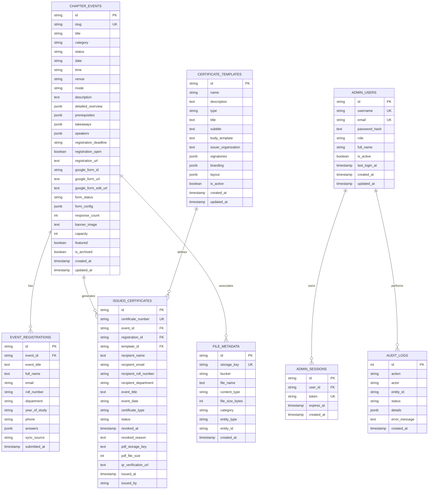

# Database Schema Documentation: Neon PostgreSQL
**System:** e-DAM IARE Production Database  
**Provider:** Neon Serverless PostgreSQL  
**Host:** AWS ap-southeast-1  

---

## Entity Relationship Overview

---

## Table Schemas & Constraints

### 1. `chapter_events`
Stores all workshops, hackathons, assemblies, and bootcamps.
- **Primary Key:** `id VARCHAR(100)`
- **Unique Key:** `slug VARCHAR(200)`
- **Indexes:** `idx_events_slug`, `idx_events_date`, `idx_events_status`
- **Soft Deletion / Archive:** `is_archived BOOLEAN DEFAULT false`

### 2. `event_registrations`
Participant registration records synchronized from Google Forms or direct entry.
- **Primary Key:** `id VARCHAR(100)`
- **Foreign Key:** `event_id` REFERENCES `chapter_events(id)` ON DELETE CASCADE
- **Indexes:** `idx_reg_event`, `idx_reg_email`, `idx_reg_roll`

### 3. `certificate_templates`
Customizable certificate formatting, colors, and institutional signatories.
- **Primary Key:** `id VARCHAR(100)`
- **Signatories:** JSONB array of objects `{ name, role, title, signatureUrl? }`
- **Layout:** JSONB `{ orientation, primaryColor, accentColor, ribbonText }`

### 4. `issued_certificates`
Official issued credentials with unique cryptographic IDs and QR verification URLs.
- **Primary Key:** `id VARCHAR(100)`
- **Unique Key:** `certificate_number VARCHAR(100)`
- **Foreign Keys:** `event_id`, `registration_id`, `template_id`
- **Storage:** `pdf_storage_key` linking to Cloudflare R2 bucket `edam-iare-media`
- **Verification URL:** `qr_verification_url` points to public verification endpoint `/verify/[certificate_number]`

### 5. `admin_users` & `admin_sessions`
Authentication subsystem with bcrypt password hashing and expiring session tokens.
- **Default Super Admin:** `admin` / `edam.iare@gmail.com`
- **Password:** Hashed with bcrypt (salt rounds: 10)

### 6. `file_metadata`
Central tracking of assets stored in Cloudflare R2.
- **Storage Key:** S3 object path (e.g., `certificates/2026/cert_xyz.pdf`, `banners/cad-summit.png`)
- **Bucket:** `edam-iare-media`

### 7. `audit_logs`
Immutable audit trail recording administrative modifications and system webhooks.

