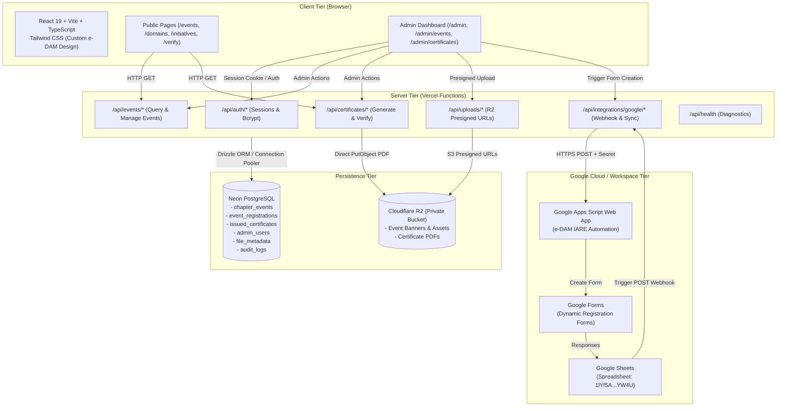

# Final Approved Technology Architecture
**System:** e-DAM IARE (Official Portal for Engineering, Design, Architecture & Multidisciplinary Student Body)  
**Host:** Vercel  
**Database:** Neon Serverless PostgreSQL  
**Storage:** Cloudflare R2  
**Automation:** Google Apps Script + Google Workspace  

---

## 1. Architectural Topology

---

## 2. Component Specifications

### 2.1 Frontend Tier
- **Framework:** React 19 with Vite 8.
- **Language:** TypeScript 5.8+ configured with strict type safety.
- **Styling:** Tailwind CSS with custom e-DAM theme:
  - Deep space background: `#030305`, surface panels `#0B0614` / `#0D071E`
  - Cyber Violet accent: `#8B5CF6`, `#7C3AED`
  - Neon Magenta accent: `#C026FF`, `#D946EF`
  - Typography: Space Grotesk (headings), Inter (body text), Fraunces (editorial italics).
- **Security:** Zero database or storage private credentials bundled in client code.

### 2.2 Serverless API Tier (Vercel Functions)
- **Runtime:** Node.js 20+ Serverless Functions.
- **Location:** `/api` directory natively supported by Vercel.
- **Responsibilities:**
  - Authenticate administrators via cryptographically secure session cookies and bcrypt.
  - Query and mutate Neon PostgreSQL using Drizzle ORM / Neon Serverless Driver.
  - Coordinate Cloudflare R2 presigned URL generation and direct PDF uploads.
  - Authenticate incoming webhooks from Google Apps Script with shared secret HMAC/token verification.

### 2.3 Database Tier (Neon PostgreSQL)
- **Engine:** Serverless PostgreSQL 16 on AWS ap-southeast-1.
- **Connection Management:** Pooled connection string (`ep-...-pooler`) for serverless function scaling; direct connection (`ep-...`) for schema migrations.
- **Data Safety:** Foreign key constraints with cascading rules, unique indexes, and audit logs on all administrative write actions.

### 2.4 Storage Tier (Cloudflare R2)
- **Bucket:** `edam-iare-media` (Private).
- **Access Protocol:** S3-Compatible API via `@aws-sdk/client-s3` and `@aws-sdk/s3-request-presigner`.
- **Security Model:** Bucket is strictly private. Objects are accessed through 15-minute presigned URLs or proxied server-side downloads.

### 2.5 Google Integration Tier
- **Apps Script:** Web App script ID `AKfycby23I_LrQVv-Ia2S4-mSUB5f1PDRmhSrZNFmLcLKdXnj2NiYmwWNbsD2cbuibfEZ8V8`.
- **Spreadsheet:** ID `1lYf5A0G3fAIp_K-zT1IDZ1dEro0bEAWJWdmPRIcYW4U`.
- **Workflow:** Real dynamic form generation; answers logged to spreadsheet and synced via installable form-submit webhook.

