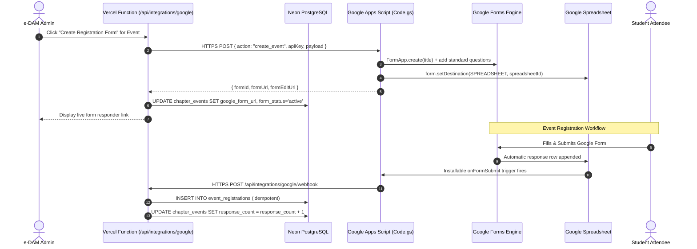

# Google Workspace & Apps Script Integration Guide
**System:** e-DAM IARE  
**Script Project:** e-DAM IARE Automation  
**Master Spreadsheet:** `1lYf5A0G3fAIp_K-zT1IDZ1dEro0bEAWJWdmPRIcYW4U`  
**Web App Deployment ID:** `AKfycby23I_LrQVv-Ia2S4-mSUB5f1PDRmhSrZNFmLcLKdXnj2NiYmwWNbsD2cbuibfEZ8V8`  
**Shared Secret Key:** `edam_iare_apps_script_key_2026`  

---

## Architecture & Integration Flow

---

## Setup & Deployment Instructions

### 1. In Google Apps Script Editor
1. Open the connected Google Sheet (`1lYf5A0G3fAIp_K-zT1IDZ1dEro0bEAWJWdmPRIcYW4U`).
2. Go to **Extensions -> Apps Script**.
3. Replace `Code.gs` with the updated contents from `google-apps-script/Code.gs`.
4. In the toolbar, select **`setupAll`** from the function dropdown and click **Run** (Grant permissions when prompted).
   - This automatically creates the 5 required tabs: `Events`, `FormRegistry`, `Registrations`, `AuditLog`, `FormConfigurations`.
   - This installs the `onFormSubmit` spreadsheet trigger.

### 2. Configure Script Properties
In Apps Script project settings (gear icon -> Script Properties), verify or set:
- `API_KEY`: `edam_iare_apps_script_key_2026`
- `SPREADSHEET_ID`: `1lYf5A0G3fAIp_K-zT1IDZ1dEro0bEAWJWdmPRIcYW4U`
- `VERCEL_WEBHOOK_URL`: `https://e-dam-iare.vercel.app/api/integrations/google/webhook`

### 3. Deploying as Web App
1. Click **Deploy -> Manage deployments -> Edit** (or New deployment).
2. Set configuration:
   - **Type:** Web app
   - **Execute as:** `Me (your Google account)`
   - **Who has access:** `Anyone` *(CRITICAL: Setting to Anyone allows the Vercel backend to communicate without OAuth authentication popups)*
3. Save and copy the Web App URL.

