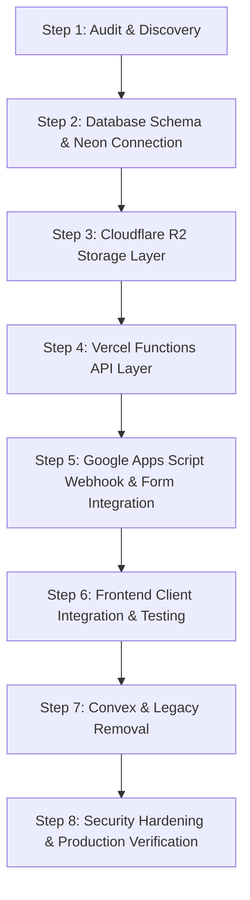

# Infrastructure Migration Plan
**Project:** e-DAM IARE  
**Objective:** Seamless migration from prototype/Convex placeholder to full-stack production architecture (Vercel Functions + Neon PostgreSQL + Cloudflare R2 + Google Apps Script) without downtime or data loss.

---

## Migration Roadmap

---

## Detailed Phases

### Phase 1: Environment & Configuration Setup
1. Define all secrets in `.env` and `.env.local`:
   - `DATABASE_URL` (pooled connection string for runtime queries)
   - `DIRECT_URL` (direct connection string for migrations)
   - `R2_ACCOUNT_ID`, `R2_ACCESS_KEY_ID`, `R2_SECRET_ACCESS_KEY`, `R2_BUCKET_NAME`, `R2_ENDPOINT`
   - `GOOGLE_APPS_SCRIPT_URL`, `GOOGLE_APPS_SCRIPT_API_KEY`, `GOOGLE_SPREADSHEET_ID`
   - `ADMIN_INITIAL_PASSWORD`, `ADMIN_JWT_SECRET`
2. Ensure no backend credentials are prefixed with `VITE_` or exposed to browser code.

### Phase 2: Database Layer (Neon PostgreSQL + Drizzle ORM)
1. Configure `drizzle.config.ts`.
2. Implement schema definitions in `src/server/db/schema.ts`:
   - `chapter_events`: Event records, dates, venues, form statuses, capacities.
   - `event_registrations`: Participant information, roll numbers, answers, sync timestamps.
   - `certificate_templates`: Certificate layouts, signatories, color schemes.
   - `issued_certificates`: Cryptographic certificate IDs, recipient details, verification URLs, R2 keys.
   - `admin_users`: Credentials with bcrypt password hashing, roles (`super_admin`, `admin`).
   - `admin_sessions`: Server-validated session tokens with expiration.
   - `file_metadata`: Cloudflare R2 object tracking, sizes, MIME types, access control.
   - `audit_logs`: Detailed operational logging for security and traceability.
3. Apply migration to Neon PostgreSQL and seed initial e-DAM events, templates, and admin user.

### Phase 3: Object Storage Service (Cloudflare R2 via AWS SDK)
1. Instantiate S3Client configured for Cloudflare R2 in `src/server/storage/r2.ts`.
2. Implement `StorageService` in `src/server/storage/storage.service.ts`:
   - Presigned upload URL generator (short expiry: 15 minutes, strict content-type and size validation).
   - Presigned download URL generator for private certificates and media.
   - Direct buffer upload utility for server-side generated certificate PDFs.
   - Object deletion with authorization check.
   - Metadata persistence in Neon `file_metadata`.

### Phase 4: Serverless API Layer (Vercel Functions)
Create modular, edge-ready Vercel API functions under `/api`:
- `/api/auth/login.ts` - Validates credentials, issues secure HTTP-only session token.
- `/api/auth/logout.ts` - Invalidates session token.
- `/api/auth/me.ts` - Returns authenticated admin state.
- `/api/events/index.ts` - GET public events (filtered), POST new event (admin only).
- `/api/events/[slug].ts` - GET event details by slug, PUT/DELETE event (admin only).
- `/api/registrations/index.ts` - GET event registrations (admin only).
- `/api/certificates/index.ts` - GET/POST certificates (admin only).
- `/api/certificates/verify/[id].ts` - Public certificate verification by certificate ID.
- `/api/uploads/presigned-url.ts` - Generates secure R2 upload URLs for admin media.
- `/api/integrations/google/create-form.ts` - Invokes Apps Script to generate real Google Form.
- `/api/integrations/google/webhook.ts` - Receives real-time Google Form submission webhooks.
- `/api/health.ts` - Live health check reporting Neon DB, R2, and Google Apps Script connectivity.

### Phase 5: Google Workspace Integration
1. Validate communication between Vercel and Google Apps Script Web App:
   - Secret key authentication (`edam_iare_apps_script_key_2026`).
   - Create Google Form action writes to Google Drive, binds to Spreadsheet `1lYf5A0G3fAIp_K-zT1IDZ1dEro0bEAWJWdmPRIcYW4U`, and returns real URLs.
   - On submission, form answers post to `/api/integrations/google/webhook` and insert idempotently into Neon `event_registrations`.

### Phase 6: Frontend Integration
1. Update API client service `src/lib/api-client.ts` to query `/api/*`.
2. Support offline/dev fallback so the UI never breaks even during offline development.
3. Wire up Admin portal:
   - Form creation triggers live Apps Script generation.
   - Certificate generation uploads PDF directly to R2 and records in Neon.
   - Public verification `/verify/:certId` queries `/api/certificates/verify/[id]`.

### Phase 7: Convex Package Deletion & Cleanup
1. Uninstall `convex` npm package.
2. Remove `convex/` folder.
3. Remove legacy ACM references.

### Phase 8: Verification & Production Build
1. Run Drizzle migration check.
2. Run TypeScript strict type verification (`tsc -b`).
3. Run Vite production build (`vite build`).
4. Generate comprehensive security audit and test reports.

