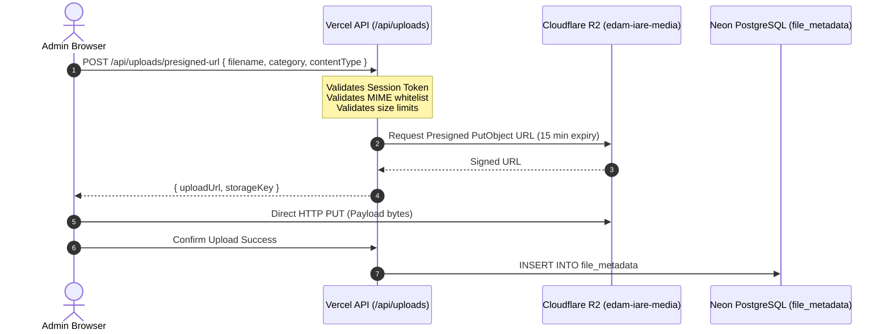

# Cloudflare R2 Storage Service Guide
**System:** e-DAM IARE  
**Bucket:** `edam-iare-media`  
**API:** S3-Compatible via AWS SDK v3 (`@aws-sdk/client-s3`, `@aws-sdk/s3-request-presigner`)  

---

## Architecture & Security Philosophy

Cloudflare R2 provides zero-egress cost, high-availability object storage for student certificates, event banners, and institutional media.



---

## Storage Key Convention

All objects are assigned collision-resistant, date-partitioned storage keys:
```
{category}/{YYYY-MM}/{timestamp}_{random6Hex}_{sanitizedFilename}
```

Examples:
- `banners/2026-11/1730472000_a8f9b2_cad_summit_cover.png`
- `certificates/2026-11/1730472000_7c3aed_cert_edam_cad_2026_001.pdf`

---

## Whitelisted Media Types & Limits

| Category | Allowed MIME Types | Max Size | Access Model |
|---|---|---|---|
| **banners** | `image/png`, `image/jpeg`, `image/webp` | 5 MB | Presigned Upload, Public CDN/Presigned Read |
| **certificates** | `application/pdf` | 10 MB | Direct Server Put / Presigned Download |
| **media** | `image/png`, `image/jpeg`, `image/webp`, `image/svg+xml` | 10 MB | Presigned Upload |
| **documents** | `application/pdf` | 15 MB | Admin Only Presigned Read |

---

## Environment Variables Required

```env
R2_ACCOUNT_ID=<your_cloudflare_account_id>
R2_ACCESS_KEY_ID=<your_r2_access_key_id>
R2_SECRET_ACCESS_KEY=<your_r2_secret_access_key>
R2_BUCKET_NAME=edam-iare-media
R2_ENDPOINT=https://<your_account_id>.r2.cloudflarestorage.com
```

> [!CAUTION]
> Never expose `R2_ACCESS_KEY_ID` or `R2_SECRET_ACCESS_KEY` in frontend bundles (`VITE_*`). Presigned URLs allow direct client uploads while keeping private keys securely on the server.

